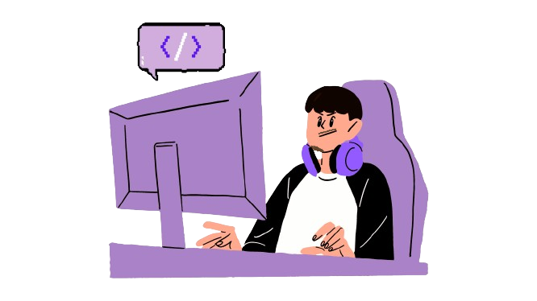
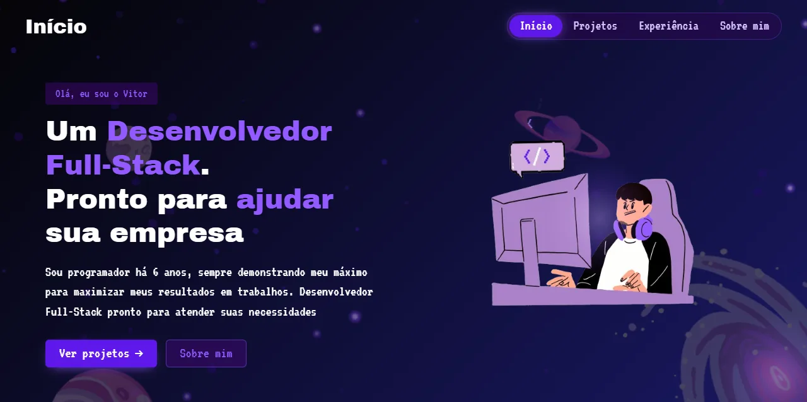
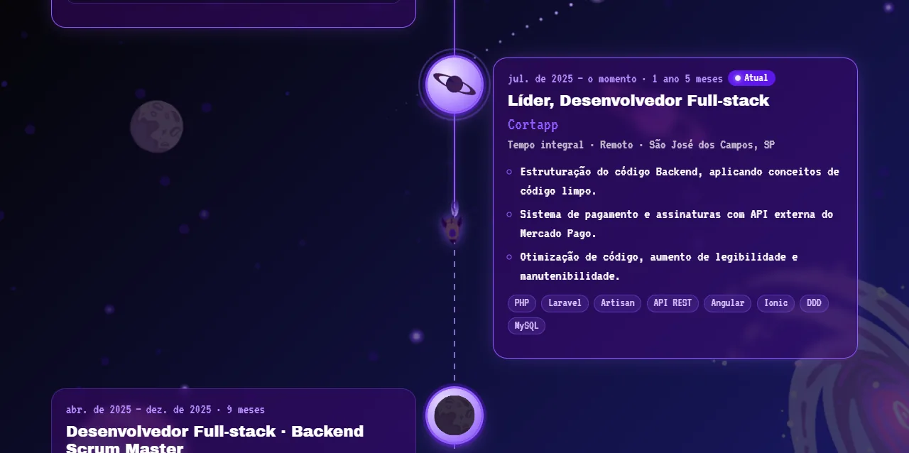
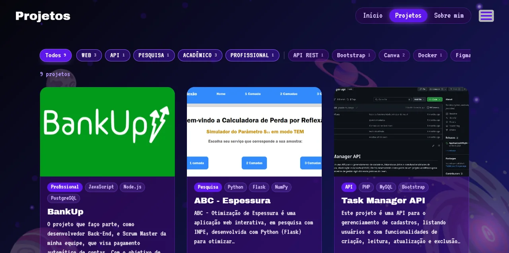
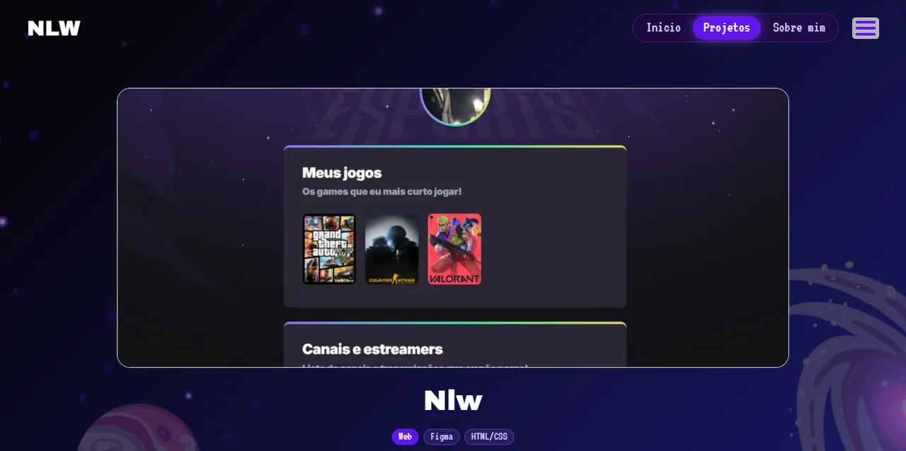
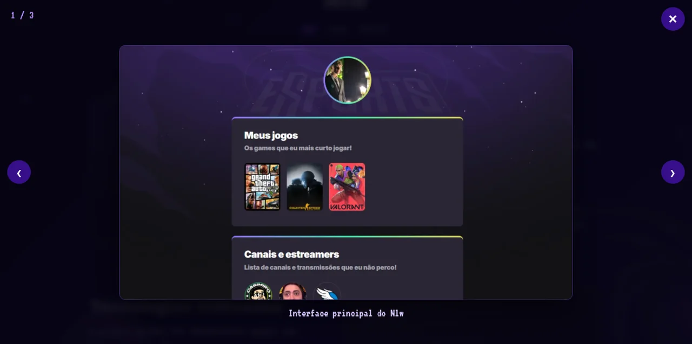
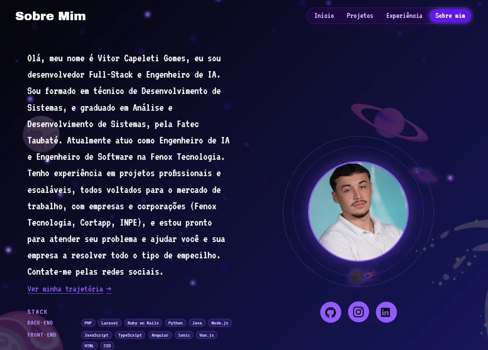

<div align="center">



# Vitor Capeleti · Portfólio Espacial

**Um portfólio em estilo espacial, todo desenhado à mão, com planetas, foguete, galáxia e um avatar programando no PC.**

<br />


<br />

### [🚀 Ver o portfólio ao vivo](https://vitorcapeleti.github.io/ProjetoPortfolio/)

</div>

---

## 🖼️ Galeria

<table>
  <tr>
    <td width="50%"></td>
    <td width="50%"></td>
  </tr>
  <tr>
    <td width="50%"></td>
    <td width="50%"></td>
  </tr>
  <tr>
    <td width="50%"></td>
    <td width="50%"></td>
  </tr>
</table>

---

## ✨ Destaques

- 🌌 **Cenário vivo**: a lua gira, Saturno balança, a galáxia ondula e o foguete voa em arcos pela tela.
- ⭐ **Céu com estrelas cintilantes e estrelas cadentes** que aparecem de tempos em tempos.
- 🎯 **Parallax** que responde ao mouse e ao scroll, dando profundidade às camadas.
- 🌀 **Transição "warp"** tipo hiperespaço entre as páginas.
- 🚀 **Loader com foguete** enquanto o site carrega.
- 🧑‍💻 **Avatar animado**: o título digita, apaga e alterna entre *Desenvolvedor Full-Stack* e *Engenheiro de IA*, e um balão `</>` solta símbolos de código.
- 🗂️ **Projetos com filtro por tag**, efeito 3D no cartão e uma imagem que "morfa" até a página do projeto.
- 🔍 **Lightbox** para ver as capturas em tamanho maior, com navegação por teclado.
- 🛰️ **Experiência**: uma trajetória espacial, com uma órbita tracejada, um nó por emprego (com os recortes da arte) e o foguete descendo a linha conforme o scroll. Traz período e duração calculados, indicadores, formação, certificados e stack.
- 🪐 **Sobre mim** com a foto orbitando os planetas e a stack agrupada.
- ♿ **Acessível**: navegação por teclado, foco visível e respeito a `prefers-reduced-motion`.
- ⚡ **Leve**: imagens em WebP otimizadas, de cerca de 15 MB para cerca de 1 MB.

---

## 🪐 Projetos

| Projeto | Tags / Stack | Repositório |
| --- | --- | --- |
| Ultron | IA, Claude Code, Node.js, TypeScript, JavaScript | [GitHub](https://github.com/VitorCapeleti/ultron-orchestrator) |
| Spac-Y | IA, Python, Flask, Ollama, Pandas | [GitHub](https://github.com/VitorCapeleti/PaymentsManagement) |
| BankUp | Profissional, JavaScript, Node.js, PostgreSQL, Docker, API REST | [GitHub](https://github.com/gitMasterAms/BankUp) |
| ABC - Espessura | Pesquisa, Python, Flask, NumPy, Matplotlib | [GitHub](https://github.com/VitorCapeleti/VariaEspessuraAuto) |
| Task Manager API | API, PHP, MySQL, Bootstrap, Kanban | [GitHub](https://github.com/VitorCapeleti/task-manager-api) |
| ATOM | Acadêmico, Figma, HTML/CSS, JavaScript, PHP, MySQL | [GitHub](https://github.com/VitorCapeleti/Atom) |
| UNITEC'S | Acadêmico, Figma, HTML/CSS, JavaScript, PHP, MySQL | [GitHub](https://github.com/VitorCapeleti/TCC) |
| DSMUSIC | Acadêmico, Canva, HTML/CSS, PHP, MySQL | — |
| NLW | Web, Figma, HTML/CSS | [GitHub](https://github.com/VitorCapeleti/nlw) |
| BALLE BOT | Web, Figma, HTML/CSS | — |
| SOUND'S | Web, Canva, Figma, HTML/CSS | — |

Os dados ficam em [`js/data/projects.js`](js/data/projects.js). Para incluir um projeto, basta adicionar um item à lista `window.PROJECTS`. A trajetória profissional, a formação e os certificados ficam em [`js/data/experience.js`](js/data/experience.js).

---

## 🧰 Stack

A stack exibida em **Sobre mim** e em **Experiência** vem de `window.STACK`, em [`js/data/experience.js`](js/data/experience.js):

| Grupo | Tecnologias |
| --- | --- |
| Back-end | PHP, Laravel, Ruby on Rails, Python, Java, Node.js |
| Front-end | JavaScript, TypeScript, Angular, Ionic, Vue.js, HTML, CSS |
| Banco de dados | SQL, MySQL, PostgreSQL |
| Arquitetura | DDD, APIs REST, Código limpo, Integração de sistemas, Metodologias ágeis |
| Ferramentas & IA | Git, GitHub, Docker, CI/CD, Claude Code |

---

## 🛠️ Tecnologias e arquitetura

O site é uma **single-page app** em HTML, CSS e JavaScript puros. Não tem etapa de build nem dependências para instalar. A única biblioteca externa é o **GSAP 3**, carregado por CDN. Se ele não estiver disponível, as animações usam CSS e Web Animations como alternativa.

- **Roteamento por hash**: `#/`, `#/projetos`, `#/projetos/<slug>`, `#/experiencia` e `#/sobre`, sem recarregar a página.
- **Arte em camadas**: os desenhos originais são recortados em partes independentes (planetas, foguete, galáxia, avatar…) pelo script `tools/slice_art.py`, o que permite animá-los separadamente.
- **Hospedagem**: GitHub Pages.

```text
.
├── index.html            # Casca da aplicação
├── css/
│   ├── style.css         # Tema espacial, layout e responsividade
│   └── views.css         # Estilos das telas (início, projetos, experiência, sobre)
├── js/
│   ├── app.js            # Inicialização
│   ├── router.js         # Rotas por hash
│   ├── scene.js          # Cenário, parallax e transição warp
│   ├── anim.js           # Animações (GSAP com fallback)
│   ├── lightbox.js       # Visualizador de capturas
│   ├── views/            # home, projects, project, experience, about
│   └── data/
│       ├── projects.js   # Dados dos projetos
│       └── experience.js # Experiência, formação, certificados e stack
├── img/
│   ├── layers/           # Recortes da arte (PNG e WebP)
│   └── opt/              # Imagens otimizadas em WebP
├── tools/
│   └── slice_art.py      # Gera as camadas a partir da arte original
├── pages/                # Redirecionamentos das páginas antigas
└── docs/preview/         # Capturas usadas neste README
```

---

## 💻 Rodando localmente

Não é preciso instalar nada. Basta servir a pasta com um servidor estático:

```bash
git clone https://github.com/VitorCapeleti/ProjetoPortfolio.git
cd ProjetoPortfolio
python -m http.server 8000
```

Depois, acesse [http://localhost:8000](http://localhost:8000). Também dá para abrir o `index.html` direto no navegador, mas alguns recursos funcionam melhor com servidor.

### Regenerando as camadas da arte

```bash
pip install pillow
python tools/slice_art.py
```

---

## 🎨 Arte autoral

Toda a ilustração do site foi **desenhada pelo Vitor**: os planetas, a lua, Saturno, a galáxia, o foguete, as estrelas e o avatar no PC. Os únicos ícones que não são autorais são os de redes sociais e empresas.

O processo foi este: a arte original, feita em uma única imagem, é recortada com o Pillow em camadas separadas. Cada camada vira um elemento independente, que pode girar, balançar, flutuar ou reagir ao mouse. A partir daí, o cenário ganha vida sem perder o traço original.

---

## 📫 Contato

Quer conversar sobre um projeto ou uma oportunidade? Me encontre por aqui:

[](https://github.com/VitorCapeleti)
[](https://www.linkedin.com/in/vitor-capeleti)
[](https://www.instagram.com/vitorcapeleti/)

---

<div align="center">

Feito com ☕, muita órbita e um foguete. 🚀

</div>
